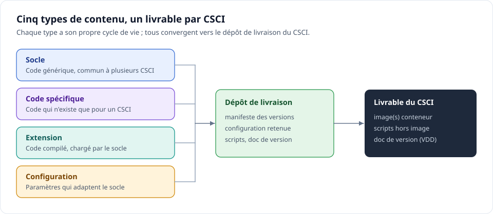
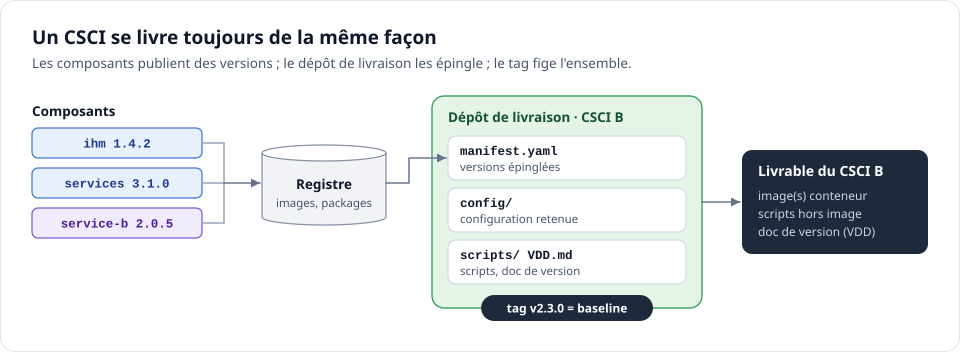
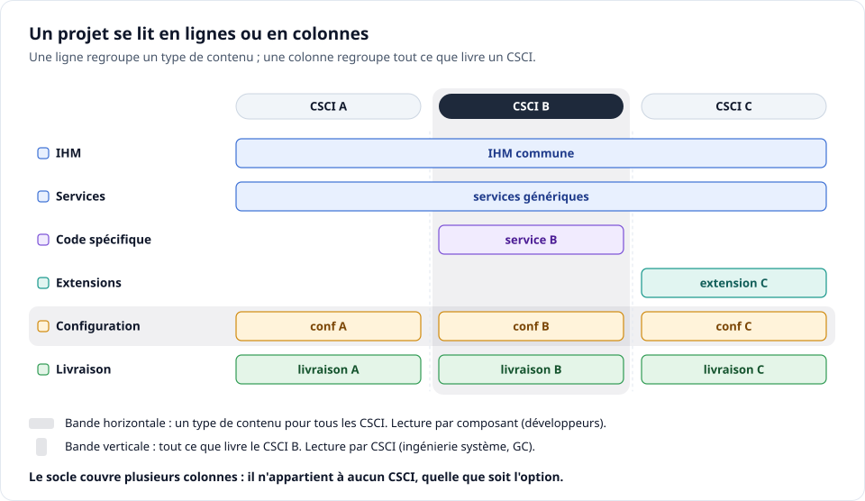
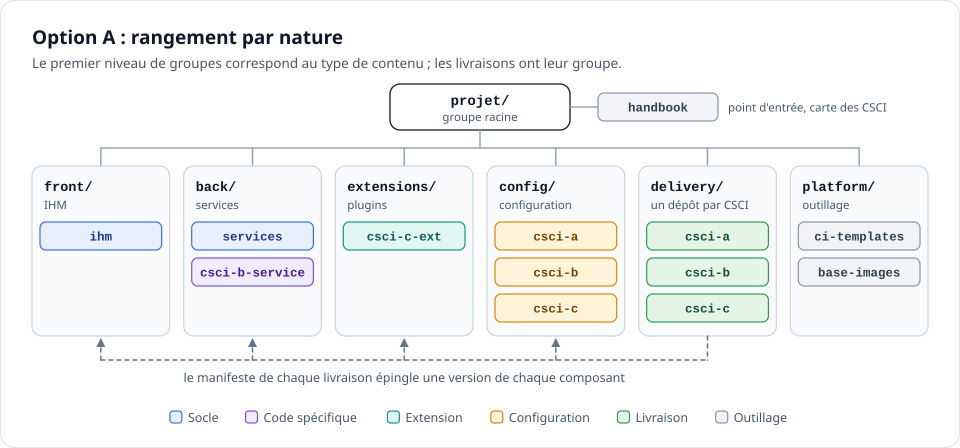
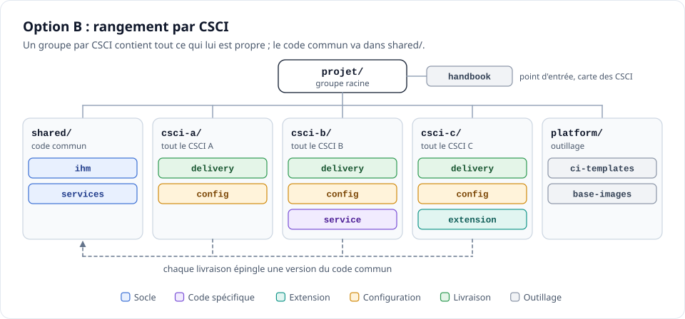
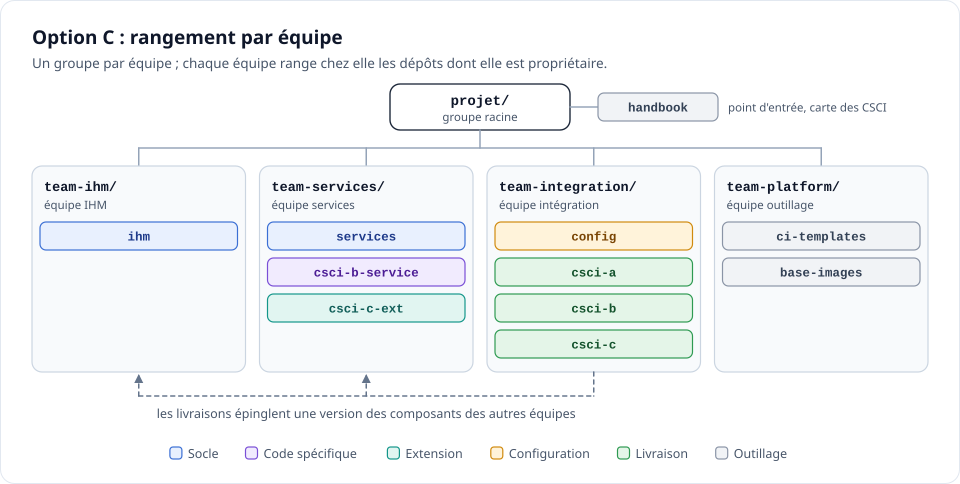
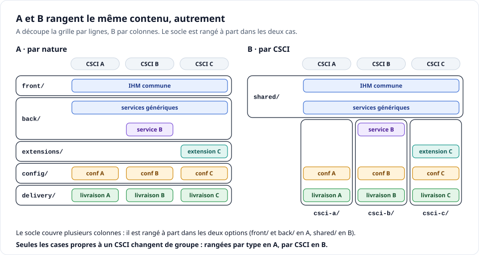
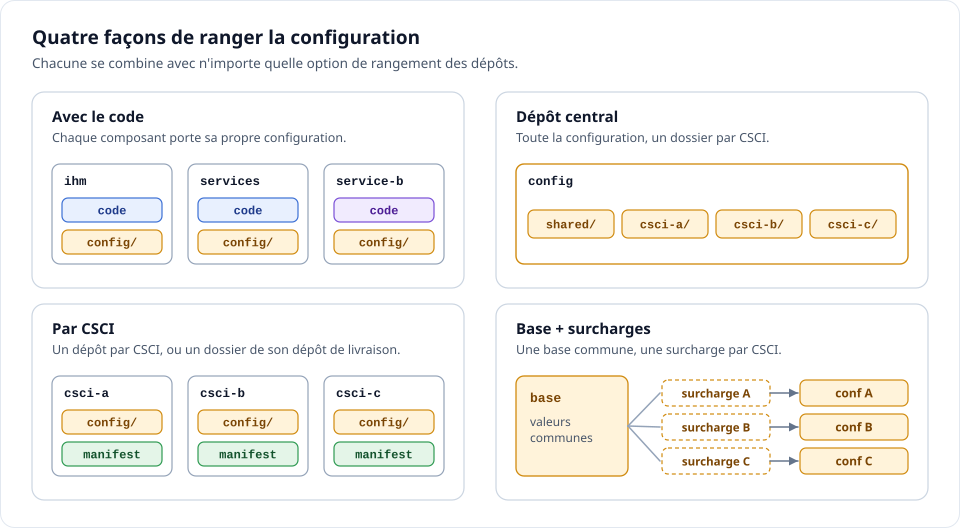
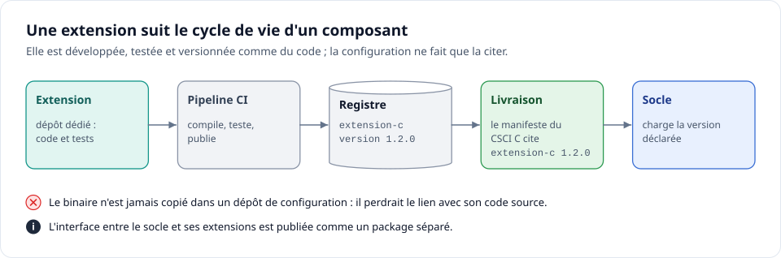

# Organiser les dépôts GitLab d'un projet livré par CSCI

*Guide de choix · version du 28 octobre 2026*

Ce guide aide à choisir comment ranger les dépôts GitLab d'un projet dont le livrable final est un CSCI. Il ne désigne pas d'option gagnante. Pour chaque contexte, il indique l'organisation qui convient, et pour qui elle sera plus difficile à vivre.

> **CSCI** (Computer Software Configuration Item, article de configuration logiciel) est préféré à « CI », pour éviter la confusion avec la CI (Continuous Integration, intégration continue).

## Sommaire

1. [Vocabulaire](#1-vocabulaire)
2. [Ce qui ne change pas, quelle que soit l'option](#2-ce-qui-ne-change-pas-quelle-que-soit-loption)
3. [Deux façons de lire un projet](#3-deux-façons-de-lire-un-projet)
4. [Les trois options en un coup d'œil](#4-les-trois-options-en-un-coup-dœil)
5. [Option A, rangement par nature](#5-option-a-rangement-par-nature)
6. [Option B, rangement par CSCI](#6-option-b-rangement-par-csci)
7. [Option C, rangement par équipe](#7-option-c-rangement-par-équipe)
8. [A ou B, ce qui change vraiment](#8-a-ou-b-ce-qui-change-vraiment)
9. [Ranger la configuration](#9-ranger-la-configuration)
10. [Extensions et code désactivé](#10-extensions-et-code-désactivé)
11. [Comparaison par critère](#11-comparaison-par-critère)
12. [Onboarding, ce qui est simple et ce qui est dur](#12-onboarding-ce-qui-est-simple-et-ce-qui-est-dur)
13. [Choisir](#13-choisir)
14. [Exemples de contextes](#14-exemples-de-contextes)
15. [Nommage](#15-nommage)
16. [Sources](#16-sources)

## 1. Vocabulaire

Un projet livré par CSCI contient cinq types de contenu. Tous finissent dans le livrable du CSCI.



| Terme | Définition | Exemple |
| --- | --- | --- |
| Socle (base) | Code générique utilisé par plusieurs CSCI ; son comportement se règle par configuration | une IHM commune, un service générique |
| Code spécifique | Code qui n'existe que pour un CSCI | un service propre au CSCI B |
| Extension (plugin) | Code développé dont le produit compilé est chargé par le socle, comme une configuration | une DLL chargée au démarrage |
| Configuration | Données qui paramètrent le socle ; souvent produites par plusieurs personnes | fichiers JSON ou YAML |
| Livraison | Ce qui assemble un CSCI : versions retenues, configuration, scripts, documentation de version | le dépôt de livraison du CSCI B |
| Outillage | Ce qui sert à construire, sans être livré | modèles de CI, images de base |
| Manifeste (manifest) | Fichier du dépôt de livraison qui liste la version exacte de chaque composant | `manifest.yaml` |
| Baseline (référence de configuration) | État figé et identifié d'un CSCI | le tag `v2.3.0` du dépôt de livraison |
| Groupe (group) | Dossier GitLab qui contient des dépôts et transmet droits, labels et jalons à son contenu | `delivery/` |

## 2. Ce qui ne change pas, quelle que soit l'option

Les options changent l'endroit où l'on range les dépôts. La façon de livrer un CSCI reste la même partout.



- **Un dépôt de livraison par CSCI.** Il contient le manifeste, la configuration retenue, les scripts et la VDD (Version Description Document, document de description de version).
- **Des artefacts versionnés.** Chaque composant publie ses images ou ses packages dans un registre (registry). Le manifeste les référence par version exacte, jamais par branche : une référence à la tête d'une branche peut changer de sens sans que le dépôt de livraison ait bougé ([Argo CD][argo]).
- **Baseline = tag du dépôt de livraison.** Le tag fige à la fois les versions et la configuration.
- **Une release GitLab par tag.** GitLab y attache automatiquement une release evidence (preuve de livraison) au format JSON ([GitLab Docs][evidence]).
- **Le livrable contient aussi ce qui n'est pas dans les images**, par exemple des scripts d'installation ou de connexion.

Exemple de manifeste :

```yaml
# manifest.yaml, dépôt de livraison du CSCI B
csci: csci-b
components:
  ihm:       { type: image, version: 1.4.2 }
  services:  { type: image, version: 3.1.0 }
  service-b: { type: image, version: 2.0.5 }
config: config/   # configuration retenue pour cette version
```

Conséquence : le choix d'organisation ne remet pas en cause la reproductibilité des livraisons. Il joue sur la lisibilité, les droits et le coût des modifications.

## 3. Deux façons de lire un projet

Un même projet se lit de deux façons. Les deux sont légitimes ; elles ne servent pas les mêmes métiers.



| Lecture | Unité de raisonnement | Question typique | Profils concernés, le plus souvent |
| --- | --- | --- | --- |
| Par composant (une ligne) | le composant technique | « Où est le code de l'IHM ? » | développeurs |
| Par CSCI (une colonne) | l'article livré | « Que contient le CSCI B, à quelle version ? » | ingénierie système, GC (gestion de configuration), responsables de CSCI |

- Une arborescence GitLab ne privilégie qu'une lecture. L'autre passe par un index : manifeste, README, labels.
- Le socle couvre plusieurs colonnes : il n'appartient à aucun CSCI et se range à part, quelle que soit l'option.
- Choisir une option revient donc à choisir la lecture qui sera directe.

## 4. Les trois options en un coup d'œil

| Option | Premier critère de rangement | Réponse directe dans l'arborescence | Réponse via un index |
| --- | --- | --- | --- |
| [A, par nature](#5-option-a-rangement-par-nature) | type de contenu : IHM, services, extensions, configuration, livraison | « Où est le code de l'IHM ? » | « Que contient le CSCI B ? » |
| [B, par CSCI](#6-option-b-rangement-par-csci) | CSCI livré | « Que contient le CSCI B ? » | « Où est le code commun, et qui l'utilise ? » |
| [C, par équipe](#7-option-c-rangement-par-équipe) | équipe propriétaire | « Qui est responsable de ce dépôt ? » | les deux questions précédentes |

**Autres découpages.** Un rangement par domaine fonctionnel revient à B quand chaque domaine correspond à un CSCI, et à C quand il correspond à une équipe. Le rangement de la configuration se choisit à part ([section 9](#9-ranger-la-configuration)).

## 5. Option A, rangement par nature



**Principe.** Le premier niveau de groupes correspond au type de contenu. Les livraisons sont regroupées dans `delivery/`, avec un dépôt par CSCI.

**Adaptée quand**

- l'essentiel du code est un socle commun, paramétré par configuration ;
- les équipes sont organisées par compétence technique (IHM, services, intégration) ;
- les modifications qui touchent plusieurs CSCI sont fréquentes ;
- les droits de développement et les droits de livraison doivent être distincts.

**Simple pour** : les développeurs (l'IHM est dans `front/`) et les intégrateurs (toutes les livraisons sont dans `delivery/`).

**Difficile pour**

- **ingénierie système et GC** : le contenu d'un CSCI n'apparaît pas dans l'arborescence ; il faut lire le manifeste de son dépôt de livraison ;
- **responsable d'un CSCI** : ce qui est propre à son CSCI (code spécifique, extension, configuration, livraison) est réparti dans plusieurs groupes.

**Point de vigilance.** Un service propre à un CSCI est rangé loin de son dépôt de livraison. Le lien passe par le manifeste et par le README du dépôt de livraison. Préfixer le nom du dépôt par le CSCI (`back/csci-b-service`) rend l'appartenance visible sans changer de groupe.

**Ce que disent les sources**

- **[Argo CD, Best Practices][argo]** recommande fortement de séparer le dépôt de configuration du code source. Motifs cités : un historique d'audit sans le bruit du développement ; une application faite de services issus de plusieurs dépôts mais déployée comme une unité ; des droits d'écriture distincts. C'est la logique des groupes `config/` et `delivery/`.
- **[Zephyr, west workspaces][west]** décrit une topologie « forêt » : un dépôt manifeste dédié, sans code source, qui liste les projets au même niveau. Elle est présentée comme adaptée à plusieurs applications indépendantes, par analogie avec l'outil `repo` de Google. C'est le rôle du dépôt de livraison d'un CSCI.

## 6. Option B, rangement par CSCI



**Principe.** Un groupe par CSCI contient tout ce qui lui est propre : livraison, configuration, code spécifique, extensions. Le code commun à plusieurs CSCI va dans `shared/`.

**Adaptée quand**

- chaque CSCI a beaucoup de code ou de configuration qui lui est propre ;
- des équipes ou des sous-traitants sont dédiés à un CSCI ;
- les droits doivent être cloisonnés par CSCI ;
- les CSCI ont des cycles de livraison indépendants ;
- l'ingénierie système et la GC sont les principaux lecteurs de l'arborescence.

**Simple pour** : l'ingénierie système, la GC, les responsables de CSCI, et tout nouvel arrivant qui raisonne par CSCI.

**Difficile pour**

- **développeurs du code commun** : leur code est dans `shared/`, séparé des CSCI qui l'utilisent ; ils naviguent entre `shared/` et chaque groupe CSCI ;
- **correctifs transverses** : avec une configuration rangée par CSCI, une modification commune demande une merge request par CSCI.

**Points de vigilance**

- B n'impose pas un dépôt d'IHM par CSCI. Une IHM commune va dans `shared/` ; seul ce qui est propre à un CSCI va dans son groupe.
- `shared/` peut devenir un fourre-tout. À l'inverse, vouloir l'éviter pousse à dupliquer du code dans chaque groupe CSCI.

**Ce que disent les sources**

- **[CMMI-DEV, CM SP 1.1][cmmi]** : un CI (configuration item, article de configuration) peut regrouper plusieurs produits liés qui forment une baseline. Ce regroupement facilite l'identification et le contrôle d'accès, et chaque CI a un propriétaire identifié. B reproduit ce regroupement dans GitLab.
- **[GitLab, Best practices to set up organizational hierarchies][gitlab-org]** : les sous-groupes rassemblent des projets liés, pour plusieurs équipes qui travaillent sur un même produit ; les droits se gèrent au niveau du groupe et s'héritent. Un groupe par CSCI s'appuie directement sur cet héritage.
- **[Team Topologies, Key Concepts][tt]** : une équipe « stream-aligned » (alignée sur un flux de valeur) possède une tranche complète, de bout en bout, sans passage de relais. Quand une équipe porte un CSCI, B fait coïncider son périmètre et son groupe GitLab.

## 7. Option C, rangement par équipe



**Principe.** Un groupe par équipe. Chaque équipe range chez elle les dépôts dont elle est propriétaire.

**Adaptée quand**

- les équipes sont stables et chacune est propriétaire d'un ensemble de composants ;
- les droits et les revues suivent les équipes ;
- le découpage des équipes ne suit ni la technique ni les CSCI (sinon, C revient à A ou à B).

**Simple pour** : les managers (qui fait quoi) et les membres d'une équipe (tout leur périmètre au même endroit).

**Difficile pour**

- **ingénierie système et GC** : le contenu d'un CSCI passe par les manifestes, comme en A ;
- **nouvel arrivant** : il faut connaître l'organigramme pour trouver un composant ;
- **tout le monde lors d'une réorganisation** : déplacer un dépôt d'un groupe à l'autre change son chemin et ses droits hérités.

**Ce que disent les sources**

- **[Conway, How Do Committees Invent? (1968)][conway]** : les organisations qui conçoivent des systèmes produisent des conceptions qui copient leurs structures de communication. C rend ce lien explicite dans GitLab.
- **[GitLab, Best practices to set up organizational hierarchies][gitlab-org]** recommande de modéliser la hiérarchie de l'organisation : groupes comme piliers, sous-groupes comme « équipes d'équipes », projets au niveau de l'équipe.
- **[Team Topologies, Key Concepts][tt]** : les limites des équipes doivent évoluer avec les produits et les technologies. Pour C, chaque évolution des équipes déplace des dépôts.

## 8. A ou B, ce qui change vraiment



Plus le socle est important, plus A et B se ressemblent. Dans les deux options, le socle est rangé à part. Seules les cases propres à un CSCI changent de groupe.

| Élément | A, par nature | B, par CSCI |
| --- | --- | --- |
| IHM commune | `front/ihm` | `shared/ihm` |
| Services génériques | `back/services` | `shared/services` |
| Service propre au CSCI B | `back/csci-b-service` | `csci-b/service` |
| Extension propre au CSCI C | `extensions/csci-c-ext` | `csci-c/extension` |
| Configuration du CSCI B | `config/csci-b`, ou un dossier d'un dépôt central | `csci-b/config` |
| Livraison du CSCI B | `delivery/csci-b` | `csci-b/delivery` |

- **Si un CSCI se résume à socle + configuration**, A et B ne diffèrent que par la place de la configuration et du dépôt de livraison.
- **Plus il y a de code propre à chaque CSCI**, plus la différence compte.
- **Une IHM unique est compatible avec les deux options** : en B, elle va dans `shared/`.
- **La question à trancher** : les éléments propres à un CSCI sont-ils rangés avec leurs semblables (A) ou avec leur CSCI (B) ?

## 9. Ranger la configuration

La configuration a souvent plusieurs producteurs. Quatre rangements existent ; chacun se combine avec n'importe quelle option.



| Rangement | Adapté quand | Difficile pour |
| --- | --- | --- |
| **Avec le code** | la configuration ne varie pas d'un CSCI à l'autre | la GC : la configuration d'un CSCI est éparpillée, et chaque modification demande une nouvelle version du composant |
| **Dépôt central** | beaucoup de producteurs ; modifications transverses fréquentes ; besoin de tout voir au même endroit | les droits : tout le monde écrit au même endroit ; l'historique mélange les CSCI |
| **Par CSCI** | CSCI indépendants ; producteurs différents par CSCI | les correctifs communs : une merge request par CSCI |
| **Base + surcharges** | beaucoup de valeurs communes, peu de différences par CSCI | la lecture : la valeur finale résulte d'une fusion ; il faut un outil qui affiche la configuration effective |

**Règles valables partout**

- valider la configuration en CI contre un schéma, pour rejeter une erreur avant fusion ;
- avec plusieurs producteurs dans un même dépôt, attribuer chaque dossier à ses propriétaires avec CODEOWNERS (propriétaires de code) : leur approbation devient obligatoire sur la branche protégée (tiers Premium et Ultimate, [GitLab Docs][codeowners]) ;
- le dépôt de livraison référence une version de la configuration, jamais une branche.

**Placement selon l'option** : en A, groupe `config/` ; en B, `csci-x/config`, avec une éventuelle base commune dans `shared/` ; en C, chez l'équipe qui produit la configuration.

**Ce que disent les sources**

- **[The Twelve-Factor App, Config][12f]** exige une séparation stricte entre configuration et code, car la configuration varie d'un déploiement à l'autre. La configuration interne, qui ne varie pas, reste dans le code. Le texte note aussi que des fichiers de configuration éparpillés rendent difficile une vue d'ensemble.
- **[Kustomize][kustomize]** gère les variantes d'une configuration avec des surcharges (overlays) appliquées à une base commune. La base et les surcharges peuvent vivre dans des dépôts différents.
- **[Argo CD, Best Practices][argo]** : un dépôt de configuration séparé donne un historique d'audit plus lisible et des droits distincts.

## 10. Extensions et code désactivé

### Extensions, le code qui devient de la configuration



Une extension est du code, même si son produit est consommé comme une configuration.

- **Un dépôt, des tests, un pipeline, une version**, comme tout composant.
- **Le produit compilé (DLL, package) est publié dans le registre.** Le manifeste ou la configuration cite sa version.
- **Le binaire n'est pas copié dans un dépôt de configuration** : il y perdrait le lien avec son code source et sa version.
- **L'interface entre le socle et ses extensions est un package à part**, publiable sans le reste de l'application ([Microsoft Learn][plugins]).
- **Une extension s'exécute dans le processus du socle.** Microsoft rappelle qu'un code non fiable ne peut pas être chargé en sécurité dans un processus .NET de confiance ([Microsoft Learn][plugins]). Une extension fournie par un tiers passe donc par le même contrôle que le reste du code.
- **Rangement** : en A, groupe `extensions/` ; en B, le groupe du CSCI qui l'utilise, ou `shared/` si plusieurs CSCI l'utilisent ; en C, l'équipe qui la développe.

### Code désactivé, un socle unique pour plusieurs configurations

Quand un même socle sert plusieurs CSCI, chaque CSCI livre du code qu'il n'utilise pas : celui que seule la configuration d'un autre CSCI active.

- Le référentiel aéronautique DO-178B/C distingue deux notions ([ISO/IEC JTC 1/SC 22/WG 23, N0297][wg23]) :
    - **dead code (code mort)** : code qui ne peut être exécuté dans aucune configuration opérationnelle et n'est traçable à aucune exigence ;
    - **deactivated code (code désactivé)** : code présent par conception, exécuté seulement dans certaines configurations, par exemple selon des options programmées.
- Un socle unique paramétré par CSCI relève du code désactivé, pas du code mort.
- Le référentiel applicable au projet peut être différent. La position de la GC est à obtenir avant de choisir entre un socle unique et un code par CSCI.
- Ce choix est indépendant de l'option de rangement : le socle se range une seule fois (`front/` en A, `shared/` en B, chez son équipe en C).

## 11. Comparaison par critère

**Simple** : servi directement par l'arborescence. **Moyen** : possible avec un index ou de l'outillage. **Difficile** : va contre l'option.

| Critère | A, par nature | B, par CSCI | C, par équipe |
| --- | --- | --- | --- |
| Trouver le code d'un composant | Simple | Moyen : `shared/` ou groupe CSCI | Moyen : il faut connaître l'équipe |
| Voir ce qui compose un CSCI | Moyen : manifeste | Simple | Moyen : manifeste |
| Modifier ce qui est propre à un CSCI | Moyen : plusieurs groupes | Simple : un seul groupe | Moyen : plusieurs équipes |
| Corriger une configuration commune à plusieurs CSCI | Simple avec un dépôt central | Moyen : une merge request par CSCI si la configuration est par CSCI | Simple si une équipe porte la configuration |
| Cloisonner les droits par CSCI | Moyen : dépôt par dépôt | Simple : droits du groupe | Difficile : un CSCI est réparti entre équipes |
| Séparer droits de développement et de livraison | Simple : groupe `delivery/` | Moyen : dépôt par dépôt, dans chaque groupe | Simple si une équipe livre |
| Ajouter un CSCI | Moyen : un dépôt dans `delivery/`, plus la configuration | Simple : un nouveau groupe, sur le même modèle | Moyen |
| Redécouper les CSCI | Simple : seuls `delivery/` et la configuration bougent | Difficile : des dépôts changent de groupe | Simple : les groupes de code ne bougent pas |
| Réorganiser les équipes | Sans effet | Sans effet | Difficile : des dépôts changent de groupe |
| Dérive à surveiller | `back/` qui grossit | `shared/` fourre-tout, ou duplication pour l'éviter | arborescence qui vieillit avec l'organigramme |

Dans les trois options, livrer un correctif du socle demande de mettre à jour le manifeste de chaque CSCI concerné. Cette étape s'automatise : la CI du composant peut ouvrir une merge request dans chaque dépôt de livraison.

## 12. Onboarding, ce qui est simple et ce qui est dur

| Profil | Première question | A | B | C |
| --- | --- | --- | --- | --- |
| Développeur | « Où est le code de ce composant ? » | Simple | Moyen | Moyen |
| Ingénierie système, GC | « Que contient ce CSCI ? » | Moyen | Simple | Moyen |
| Responsable de CSCI | « Où est tout ce qui concerne mon CSCI ? » | Difficile | Simple | Difficile |
| Manager | « Qui fait quoi ? Où en est chaque CSCI ? » | Moyen | Simple pour l'avancement par CSCI | Simple pour « qui fait quoi » |
| Intégrateur | « Où sont les livraisons ? » | Simple | Moyen : une par groupe | Simple si une équipe livre |

- **Le plus dur à comprendre, quelle que soit l'option** : le lien entre composants et CSCI, c'est-à-dire qui utilise quoi, et à quelle version. C'est le rôle du manifeste, et d'une carte des CSCI dans le dépôt `handbook`.
- **Le plus simple à comprendre** : une arborescence qui suit la façon dont on raisonne déjà. Elle est donc simple pour un profil et moins pour l'autre ; aucune option n'y échappe.

**Rendre l'option choisie lisible pour l'autre lecture**

| Option choisie | Pour la lecture par CSCI | Pour la lecture par composant |
| --- | --- | --- |
| A | carte des CSCI dans le `handbook` ; manifestes lisibles ; labels par CSCI (`csci-a`, `csci-b`) sur les issues et les merge requests | déjà directe |
| B | déjà directe | `shared/` cité en tête du README racine ; dans chaque groupe CSCI, un README qui renvoie au code commun utilisé ; recherche GitLab depuis le groupe racine |
| C | carte des CSCI dans le `handbook` ; manifestes ; labels par CSCI | carte « composant → équipe » dans le `handbook` |

## 13. Choisir


Les questions vont des contraintes les plus dures (droits) aux préférences (lisibilité). La première réponse « oui » décide de l'option.

Puis choisir le rangement de la configuration :

| Situation | Rangement |
| --- | --- |
| Configuration identique pour tous les CSCI | Avec le code |
| Nombreux producteurs, modifications transverses fréquentes | Dépôt central |
| Beaucoup de valeurs communes, quelques différences par CSCI | Base + surcharges |
| CSCI indépendants, producteurs distincts par CSCI | Par CSCI |

## 14. Exemples de contextes

Six situations types. Les noms de CSCI sont génériques.

### Exemple 1. Petite équipe, produit configurable

- **Contexte** : une petite équipe ; une IHM et deux services ; trois CSCI qui ne diffèrent que par la configuration ; les correctifs touchent souvent les trois CSCI.
- **Choix** : A, avec un dépôt de configuration central.
- **Pourquoi** : le contenu propre à chaque CSCI se limite à la configuration et à la livraison, donc A et B sont presque identiques ([section 8](#8-a-ou-b-ce-qui-change-vraiment)). Le dépôt central évite une merge request par CSCI pour chaque correctif.
- **Qui devra s'adapter** : la GC, qui lit chaque CSCI dans son dépôt de livraison.

### Exemple 2. Socle commun, équipes par compétence

- **Contexte** : plusieurs équipes (IHM, services, intégration) ; un socle commun à tous les CSCI ; une configuration produite par plusieurs métiers ; quelques extensions par CSCI.
- **Choix** : A, configuration en base + surcharges.
- **Pourquoi** : le socle et la configuration sont majoritaires et rangés par nature ; les livraisons restent isolées dans `delivery/`.
- **Qui devra s'adapter** : l'ingénierie système et la GC, aidées par la carte des CSCI, des manifestes lisibles et des labels par CSCI.

### Exemple 3. Une équipe par CSCI

- **Contexte** : une équipe par CSCI ; peu de code commun ; des livraisons à des dates différentes.
- **Choix** : B, configuration par CSCI ; `shared/` limité aux bibliothèques communes, publiées en packages versionnés.
- **Pourquoi** : chaque équipe a tout son périmètre dans un groupe ; droits et revues suivent le groupe.
- **Qui devra s'adapter** : les quelques développeurs du code commun. La duplication entre groupes est à surveiller.

### Exemple 4. CSCI confiés à des sous-traitants distincts

- **Contexte** : chaque CSCI est réalisé par un sous-traitant qui ne doit voir que son périmètre.
- **Choix** : B, droits posés sur chaque groupe CSCI ; le socle est fourni en lecture seule ou sous forme de packages.
- **Pourquoi** : GitLab gère les droits par groupe et par projet ; un groupe par CSCI les pose en une fois.
- **Qui devra s'adapter** : l'équipe du socle, qui publie des versions consommables par les sous-traitants.

### Exemple 5. Équipes stables, propriétaires de composants

- **Contexte** : une organisation durable ; chaque équipe possède des composants utilisés par plusieurs CSCI ; les équipes ne sont découpées ni par technique ni par CSCI ; une équipe d'intégration livre tous les CSCI.
- **Choix** : C, avec les dépôts de livraison chez l'équipe d'intégration.
- **Pourquoi** : la propriété et les revues sont claires ; la livraison reste centralisée.
- **Qui devra s'adapter** : l'ingénierie système et la GC, via les manifestes ; tout le monde lors des réorganisations.

### Exemple 6. Socle important et pilotage par CSCI

- **Contexte** : un socle commun majoritaire, porté par des équipes transverses ; l'ingénierie système et la GC pilotent par CSCI.
- **Ce qui fait hésiter** : la GC lit par CSCI, les développeurs par composant. Les deux lectures pèsent.
- **Ce que coûte chaque option** : A coûte un index à la GC (carte des CSCI, manifestes, labels). B coûte aux développeurs des allers-retours entre `shared/` et les groupes CSCI.
- **Départage** : si la GC exige des droits ou des approbations propres à chaque CSCI, B, avec l'IHM et les services communs dans `shared/`. Sinon, A, avec une carte des CSCI tenue à jour.

## 15. Nommage

**Règles générales**

- un nom dit le rôle, pas la personne ni l'équipe (sauf en option C) ;
- minuscules et tirets (`csci-b-service`) : le nom sert à la fois de chemin dans l'URL et de nom de dossier au clonage ; le garder court ([GitLab Handbook][gitlab-lab]) ;
- anglais pour les noms techniques, comme le code ;
- l'identifiant GC du CSCI tel quel (`csci-b`), pour une correspondance immédiate avec la documentation de GC.

| Rôle | Nom conseillé | Alternatives rencontrées | Pourquoi |
| --- | --- | --- | --- |
| Code commun à plusieurs CSCI | `shared` | `common`, `core`, `base` | dit « partagé » ; `core` évoque une bibliothèque centrale ; `base` est vague |
| Livraison d'un CSCI | `delivery` | `release`, `builder`, `dist` | dit le rôle ; `release` se confond avec les Releases GitLab ; `builder` évoque un outil de build, pas une livraison |
| Configuration | `config` | `conf`, `cfg`, `settings` | mot complet, sans abréviation |
| Extensions | `extensions` | `plugins`, `addons`, `modules` | `modules` se confond avec les modules Angular ou .NET |
| Outillage partagé | `platform` | `tooling`, `infra`, `ci` | terme établi pour ce rôle (« platform team » chez Team Topologies) ; `ci` se confond avec CSCI |
| Point d'entrée | `handbook` | `docs`, `wiki`, `onboarding` | un seul dépôt d'accueil : carte des CSCI, conventions, guide du premier jour |

## 16. Sources

**Option A**

- [Argo CD, Best Practices][argo] : séparer configuration et code source.
- [Zephyr Project, West Workspaces][west] : dépôt manifeste dédié, topologie « forêt ».

**Option B**

- [CMMI-DEV v1.3, CM SP 1.1 Identify Configuration Items (wibas)][cmmi] : un CI regroupe des produits liés ; identification, contrôle d'accès, propriétaire.
- [GitLab, Best practices to set up organizational hierarchies that scale (2024)][gitlab-org] : sous-groupes et héritage des droits.
- [Team Topologies, Key Concepts][tt] : équipes alignées sur un flux de valeur, de bout en bout.

**Option C**

- [Melvin E. Conway, How Do Committees Invent?, Datamation, 1968][conway] : la loi de Conway.
- [GitLab, Best practices to set up organizational hierarchies that scale (2024)][gitlab-org] : modéliser l'organisation dans les groupes.
- [Team Topologies, Key Concepts][tt] : des limites d'équipe qui évoluent.

**Configuration**

- [The Twelve-Factor App, III. Config][12f]
- [Kustomize, introduction][kustomize]
- [GitLab Docs, Code Owners][codeowners]

**Extensions et code désactivé**

- [Microsoft Learn, Create a .NET Core application with plugins][plugins]
- [ISO/IEC JTC 1/SC 22/WG 23, N0297, Dead and Deactivated Code][wg23] : cite les définitions de DO-178B.

**Livraison et nommage**

- [GitLab Docs, Release evidence][evidence]
- [GitLab Handbook, Hands-On Lab: Structuring your Organization][gitlab-lab]

[argo]: https://argo-cd.readthedocs.io/en/stable/user-guide/best_practices/
[west]: https://docs.zephyrproject.org/2.7.5/guides/west/workspaces.html
[cmmi]: https://www.wibas.com/cmmi/cmsp-11-identify-configuration-items
[gitlab-org]: https://about.gitlab.com/blog/best-practices-to-set-up-organizational-hierarchies-that-scale/
[tt]: https://teamtopologies.com/key-concepts
[conway]: http://www.melconway.com/Home/Committees_Paper.html
[12f]: https://12factor.net/config
[kustomize]: https://kubectl.docs.kubernetes.io/guides/introduction/kustomize/
[codeowners]: https://docs.gitlab.com/user/project/codeowners/
[plugins]: https://learn.microsoft.com/en-us/dotnet/core/tutorials/creating-app-with-plugin-support
[wg23]: https://www.open-std.org/JTC1/SC22/WG23/docs/ISO-IECJTC1-SC22-WG23_N0297-proposed-revision-xqy-keaton-2010-12-15.pdf
[evidence]: https://docs.gitlab.com/user/project/releases/release_evidence/
[gitlab-lab]: https://handbook.gitlab.com/handbook/customer-success/professional-services-engineering/education-services/ilt-labs/gitlabpmhandsonlab1/